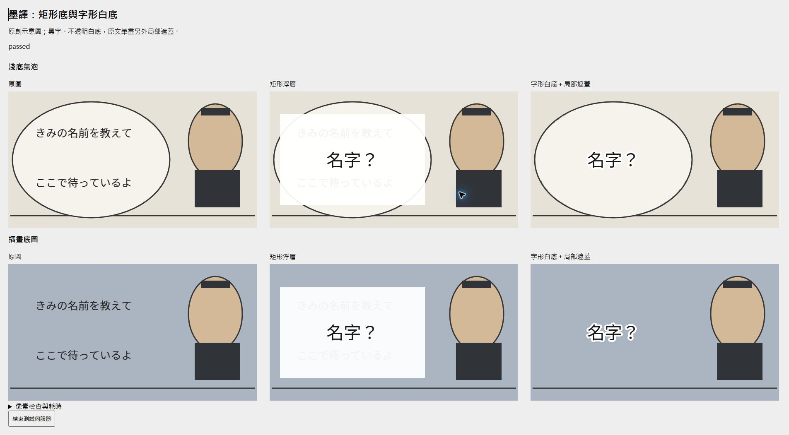

# 墨譯 Comic Transcriber

把網頁上的日文漫畫翻成繁體中文。墨譯是 Chrome／Edge 擴充套件，會偵測文字框、辨識日文、翻譯，再把譯文放回圖片。整章依序處理，每張完成就顯示在原網頁，閱讀時可以隨時切回原圖。

目前版本為 **0.1.11**，採 Manifest V3，核心程式以 Apache-2.0 授權。各版本的新增、修正與使用方式變更見 [版本更新日誌](CHANGELOG.md)。

## 功能

- **整章翻譯**：收集閱讀區圖片，最多兩張在途，重疊下一張 OCR 與上一張翻譯；每張完成就顯示，支援停止佇列與續翻。
- **整章二段校正**：Google 完成初譯後，匿名 Gemini 一次讀取整章原文與初譯，統一稱呼、術語與語氣。完整核對回覆後逐張重排，保留 Google 初譯供逐框還原。
- **原頁閱讀**：譯文直接套回原網頁，全章或單張均可切換原圖。
- **章節工作台**：載入全部縮圖，切換圖片、修改原文與譯文、增刪文字框或調整座標。
- **自適應嵌字**：原文筆畫先局部補色，中文依氣泡空間選擇橫／直排，使用沿字形收縮的不透明白底。工作台可逐框調整方向與字級倍率，保留矩形浮層及手動白底模式，支援 PNG 與校正 JSON 匯出、匯入。
- **本機 OCR**：ONNX 文字與氣泡偵測、Manga-OCR 日文辨識，預設 WASM；處理一般圖片、懶載入圖片及可讀取的 blob 圖片。WebGPU 可在設定中選用。
- **圖片快取**：保存文字框、原文與譯文。重新整理後再次翻譯可復用完成的結果；圖片內容或相關設定改變時重新處理。
- **快取管理**：列出頁面、校正、下載模型的內容大小與保存時間，依來源、日期或大小查找，支援單頁、模型群組及整類刪除。套件資源、儲存估算與 Chrome 語言包分別顯示。
- **浮動工具**：拖曳標題移動工具列，收合為浮球；擴充套件圖示提供隱藏與恢復。「暫停並釋放」完成在途圖片後釋放推論資源。

## 翻譯來源

預設使用 Google 免金鑰網頁翻譯。OCR 與嵌字留在本機，只有辨識出的文字送至 Google，因此這個模式無需載入本機大型翻譯模型。

| 來源 | 執行位置 | 使用條件 |
|---|---|---|
| Google 網頁翻譯 | Google 匿名網頁端點 | 需要網路；免帳號、API key 與 API 費用 |
| Chrome Translator API | 瀏覽器本機模型 | 取決於瀏覽器及語言對是否可用；首次下載語言包 |
| 匿名 Gemini 整章校正（實驗） | Gemini 網站自動選擇模型 | 作為 Google 初譯後的二段校正；需網站權限與協定驗證，僅傳整章文字與術語 |
| WebLLM | 本機 WebGPU | Qwen3.5 0.8B／2B Q4；需要相容 GPU、模型下載及足夠記憶體 |
| OpenAI-compatible 本機服務 | localhost | 設定 Ollama、llama.cpp 或相容服務的端點及模型名稱 |

Google 網頁端點屬於非官方介面，可能限流、失敗或改變格式。HTTP 500／502／503／504 最多重試兩次，分別等待 2 秒及 5 秒；403／429 會停止佇列，保留完成的對白。Google Cloud Translation 的計費 API 未接入。

本機服務備援預設關閉，啟用後才會把文字交給設定的 localhost 端點。人名、術語及前頁對白上下文用於本機 LLM 翻譯。各來源的資料流與模型需求見 [部署說明](docs/development.md)。

匿名 Gemini 使用擴充套件直接請求網站的方式，所有請求均省略帳號憑證。回覆依頁面與區域 ID 核對，缺漏、重複或額外區域均拒絕套用。提交後斷線會保存「結果未知」並鎖定相同輸入，需在設定頁人工確認解除；403／429 或協定失敗會停止後續請求。30 批原創短句用於連線與格式驗證，漫畫的人名、語氣與可讀性另行評分。這個入口依賴非官方協定，可用性與網站預設模型可能改變；[0.1.10 量測](docs/research-0.1.10.md) 與 [0.1.11 校正紀錄](docs/research-0.1.11.md) 分別列出驗證範圍。

## 安裝

目前以原始碼建置並載入未封裝擴充套件。準備 Node.js 24 與 npm，在終端機執行：

```sh
git clone https://github.com/show940125/comic-transcriber.git
cd comic-transcriber
npm ci
npm run assets
npm run build
```

`npm run assets` 下載 ONNX／WebLLM 執行資源與繁中字型，沿用鎖定的模型版本及 SHA-256。建置完成後：

1. 開啟 `chrome://extensions` 或 `edge://extensions`。
2. 啟用「開發人員模式」，按「載入未封裝項目」。
3. 選取專案中的 `.output/chrome-mv3` 資料夾。
4. 在漫畫網站點擴充套件，選「授權目前網站並重新整理」。
5. 點「啟用本頁墨譯」，或從圖片右鍵選單啟用。需要自動處理時，在設定勾選指定網站。

OCR 權重首次使用時下載並快取，約 450 MiB。預先打包 OCR 權重的方式見 [離線建置](docs/development.md#離線建置)。

## 翻譯與校正

在漫畫頁右下角按「翻譯本頁漫畫」。每張圖片完成就會替換為繁中版本；「停止佇列」會完成已開始的最多兩張，按「繼續翻譯本頁」接著處理剩餘圖片。「取消處理」中止目前任務，保留已存文字與完成圖片。

Google 初譯維持預設。設定中的「整章 Gemini 二段校正」可啟用初譯完成後自動校正；先按「準備整章 Gemini 校正」取得權限並檢查協定。已通過的 30 批驗證可以沿用。也可在工具列按「整章 Gemini 校正」稍後執行。一次送出整章各頁原文、初譯、目前譯文及術語，核對完整回覆後逐張套用；工作台的「Google 初譯」可還原單框。

整章校正上限為 60 張、800 個可校正區域、120 KB 輸入資料。超過上限會提示並保留初譯；原文待覆核的區域只作背景，繼續保留人工校正。圖片或文字變更時拒收舊結果，術語變更後可重新校正。網路或格式失敗不影響初譯；回填期間取消則保留已完成圖片與初譯。

按「原圖／譯文」切換全部完成的圖片，或雙擊單張圖片切換。需要校正時開啟「章節工作台」，從縮圖或圖片選單選頁，再選文字框修改原文、譯文、呈現方式、中文方向及字級倍率。漏掉的對白可手動框選，修改後按「套用至漫畫頁」。

模型設定中的「在途圖片」可切回一張以降低記憶體。Google 請求與 OCR 推論各自保持串行；WebLLM／本機 LLM 採單頁流程。Chrome 本機翻譯需先在設定頁準備語言包，確認推論文件就緒。

圖片由另一個 CDN 提供時，工作台會顯示缺少授權的來源。按「授權圖片來源並重試」後繼續。擴充套件更新後，需在管理頁重新載入，再重新整理漫畫分頁。

## 快取與資源

從擴充套件圖示或設定開啟「快取與資源管理」。頁面文字與校正最多保留 30 份；舊資料缺少網址或時間時顯示「未記錄」。下載模型的舊快取可按「串流掃描模型大小」計量，掃描逐段讀取內容。刪除頁面會一併移除原文、譯文與人工校正；使用中的任務須先暫停並等待收尾。套件內建模型、WASM 與字型隨安裝保留。

工具列可拖曳、縮成浮球，位置與收合偏好保存在本機；隱藏狀態按分頁保存。隱藏期間翻譯繼續執行，重新顯示由擴充套件圖示操作。暫停會停止接納新圖片，完成已開始的最多兩張後釋放模型。

新安裝預設按需注入頁內工具，未啟用網站不建立漫畫觀察器或推論 Worker。全部任務結束 60 秒後，擴充套件終止 Worker、釋放自有模型與 Translator 會話並關閉 offscreen 文件；下次使用重新建立。已顯示譯圖、基本擴充套件程式與 Chrome 管理的共用資源仍可能占用記憶體。快取頁的磁碟內容大小與儲存估算均不代表 RAM。

WASM 執行緒可選 `auto`、1、2 或 4；新設定於模型釋放後重新建立時生效。多執行緒需要隔離文件、SharedArrayBuffer 與可用 pthread，條件不足時降回 1 並保留原因。`auto` 維持單執行緒，直到有合格的本機完整流程量測。原生 ONNX OCR 服務也提供 `--threads 1|2|4`，仍由使用者另行啟動與關閉。

## 已知限制

日文 OCR 可能誤認低解析度、手寫字、藝術字或背景紋理；短句翻譯也可能失去語氣、人物稱呼或上下文。原文與校正欄會保留，方便逐框核對。一般對白的正式辨識與翻譯品質評分仍待獨立人工標註。

字形白底使用 Canvas 局部背景補色，適合淺底氣泡與單色背景。閉合與格邊開口氣泡會分別處理，中文排版限制在辨認出的內部範圍。複雜畫線、網點或無法安全分離的區域會顯示校正警示，可逐框改用「矩形浮層（舊方式）」或手動白底。網點上的補色可能留下修補痕跡，完整神經修圖尚未加入。網站圖片的篩選依閱讀區與尺寸判斷；canvas、封閉 Shadow DOM 或特殊閱讀器需另行適配，網站自身的圖片畫廊也可能沿用原圖。

下圖使用原創示意圖比較呈現方式：左欄為原圖，中欄為矩形浮層，右欄為局部清除原文後的字形白底。右欄保留氣泡邊線與周圍背景，中文周圍的白底保持不透明。



WebLLM 的長章節穩定性取決於 GPU 與可用記憶體；0.8B／2B 模型在 Intel UHD 730 的長跑曾出現格式或 GPU 失效問題。需要穩定的長章節翻譯時，建議使用預設 Google 模式，或明確設定本機服務。Chrome Translator API 的本機核心已完成離線基準，擴充套件原點的語言包初始化仍需依環境驗證。

## 開發

```sh
npm run typecheck
npm test
npm run dev
```

程式以 TypeScript、WXT 與 Svelte 建置。Content script 處理原頁圖片、佇列及校正介面；service worker 管理訊息與網路代理；offscreen 文件承載推論 Worker。OCR 採 WASM 與可用的 WebGPU 路徑，重運算放在 Worker。

0.1.11 通過 91 個測試與型別檢查，涵蓋整章校正、初譯保存、快取、閒置釋放、更新失效、兩張佇列及限流。Chrome 實際完成 17 張、128 個區域的 Google 初譯與 Gemini 整章校正回填。修改數與翻譯品質評分分開，驗證範圍見 [0.1.11 紀錄](docs/research-0.1.11.md)。

0.1.10 的 17 張、固定翻譯延遲 CPU 比較，WASM 4 執行緒暖機中位耗時為 106 秒，單執行緒為 245 秒，辨識文字一致；完整流程包含偵測、OCR、嵌字與 PNG 編碼。匿名 Gemini 的 30 批短句驗證用於協定測試。量測條件、前處理差異、頁面反應及品質限制見 [研究與量測](docs/research-0.1.10.md)；歷史紀錄見 [開發文件](docs/development.md)。人工翻譯品質評分另行驗收。

## 授權

核心程式採 [Apache-2.0](LICENSE)。依賴、字型與模型各有授權，來源列於 [NOTICE.md](NOTICE.md)；模型版本及雜湊列於 [src/model-lock.json](src/model-lock.json)。MLC 轉換產物的授權標記仍需在正式發佈前覆核。

Repository 保存原始碼、測試與模型清單。漫畫、翻譯圖片、瀏覽器 profile、權重及建置產物留在本機；處理或散布漫畫內容時，應遵守作品的使用條件。
