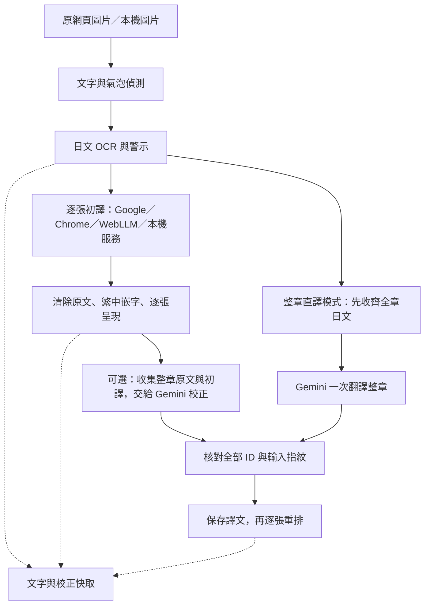

# 墨譯 Comic Transcriber

把網頁上的日文漫畫翻成繁體中文。墨譯是 Chrome／Edge 擴充套件，會偵測文字框、辨識日文、翻譯，再把譯文放回圖片。整章依序處理，每張完成就顯示在原網頁，閱讀時可以隨時切回原圖。

目前版本為 **0.1.15**，採 Manifest V3，核心程式以 Apache-2.0 授權。各版本的新增、修正與使用方式變更見 [版本更新日誌](CHANGELOG.md)。

## 功能

- **整章翻譯**：收集閱讀區圖片，最多兩張在途，重疊下一張 OCR 與上一張翻譯；每張完成就顯示，支援停止佇列與續翻。
- **漫畫專屬翻譯指示**：在設定的「故事上下文」補充作品語氣、角色稱呼與用詞偏好，供 Gemini 整章校正與本機 LLM 使用；修改後可沿用 Google 初譯重跑校正。
- **整章 Gemini 直譯**：先收齊整章日文 OCR，一次送出全部原文直接翻譯，省去逐框 Google 請求；完整核對回覆後逐張呈現。可在頁內工具列或設定切換，Google 初譯模式維持預設。
- **整章二段校正**：Google 完成初譯後，匿名 Gemini 一次讀取整章原文與初譯，統一稱呼、術語與語氣。完整核對回覆後逐張重排，保留 Google 初譯供逐框還原。
- **原頁閱讀**：譯文直接套回原網頁，全章或單張均可切換原圖。
- **章節工作台**：載入全部縮圖，切換圖片、修改原文與譯文、增刪文字框或調整座標。
- **自適應嵌字**：原文筆畫先局部補色，中文依氣泡空間選擇橫／直排，使用沿字形收縮的不透明白底。工作台可逐框調整方向與字級倍率，保留矩形浮層及手動白底模式，支援 PNG 與校正 JSON 匯出、匯入。
- **本機 OCR**：ONNX 文字與氣泡偵測、Manga-OCR 日文辨識，預設 WASM；處理一般圖片、懶載入圖片及可讀取的 blob 圖片。WebGPU 可在設定中選用。
- **圖片快取**：保存文字框、原文與譯文。重新整理後再次翻譯可復用完成的結果；圖片內容或相關設定改變時重新處理。
- **快取管理**：列出頁面、校正、下載模型的內容大小與保存時間，依來源、日期或大小查找，支援單頁、模型群組及整類刪除。套件資源、儲存估算與 Chrome 語言包分別顯示。
- **浮動工具**：拖曳標題移動工具列，收合為浮球；擴充套件圖示提供隱藏與恢復。「暫停並釋放」完成在途圖片後釋放推論資源。

## 翻譯來源

預設使用 Google 免金鑰網頁翻譯。OCR 與嵌字留在本機，只有辨識出的文字送至 Google，因此這個模式無需載入本機大型翻譯模型。

| 來源 | 執行位置 | 使用條件 |
|---|---|---|
| Google 網頁翻譯 | Google 匿名網頁端點 | 需要網路；免帳號、API key 與 API 費用 |
| Chrome Translator API | 瀏覽器本機模型 | 取決於瀏覽器及語言對是否可用；首次下載語言包 |
| 匿名 Gemini 整章翻譯／校正（實驗） | Gemini 網站自動選擇模型 | 可整章直接翻譯，或接續 Google 初譯校正；需網站權限與協定驗證，僅傳整章文字與術語 |
| WebLLM | 本機 WebGPU | Qwen3.5 0.8B／2B Q4；需要相容 GPU、模型下載及足夠記憶體 |
| OpenAI-compatible 本機服務 | localhost | 設定 Ollama、llama.cpp 或相容服務的端點及模型名稱 |

Google 網頁端點屬於非官方介面，可能限流、失敗或改變格式。HTTP 500／502／503／504 最多重試兩次，分別等待 2 秒及 5 秒；403／429 會停止佇列，保留完成的對白。Google Cloud Translation 的計費 API 未接入。

本機服務備援預設關閉，啟用後才會把文字交給設定的 localhost 端點。人名、術語及前頁對白上下文用於本機 LLM 翻譯。各來源的資料流與模型需求見 [部署說明](docs/development.md)。

匿名 Gemini 使用擴充套件直接請求網站的方式，所有請求均省略帳號憑證。回覆依頁面與區域 ID 核對，缺漏、重複或額外區域均拒絕套用。提交後斷線會保存「結果未知」並鎖定相同輸入，需在設定頁人工確認解除；403／429 或協定失敗會停止後續請求。首次使用會先確認匿名協定與回覆格式。這個入口依賴非官方協定，可用性與網站預設模型可能改變；[0.1.10 量測](docs/research-0.1.10.md) 與 [0.1.11 校正紀錄](docs/research-0.1.11.md) 分別列出驗證範圍。

## 安裝

從 [最新 Release](https://github.com/show940125/comic-transcriber/releases/latest) 下載 `comic-transcriber-版本-offline-vision.zip`，完整解壓縮至固定資料夾。開啟 `chrome://extensions` 或 `edge://extensions`，啟用「開發人員模式」，按「載入未封裝項目」，選取含 `manifest.json` 的解壓縮資料夾。離線 OCR 套件已包含辨識權重；Google／Gemini 翻譯仍需網路。

更新時將新版完整解壓縮至原安裝位置，回擴充套件管理頁按「重新載入」，再重新整理漫畫分頁。

原始碼建置需要 Node.js 24 與 npm，在終端機執行：

```sh
git clone https://github.com/show940125/comic-transcriber.git
cd comic-transcriber
npm ci
npm run assets
npm run build
```

`npm run assets` 下載 ONNX／WebLLM 執行資源與繁中字型，沿用鎖定的模型版本及 SHA-256。建置完成後：

1. 開啟 `chrome://extensions` 或 `edge://extensions`。
2. 啟用「開發人員模式」，按「載入未封裝項目」。
3. 選取專案中的 `.output/chrome-mv3` 資料夾。
4. 在漫畫網站點擴充套件，按「啟用本頁墨譯」。
5. 也可從圖片右鍵選單啟用；需要自動處理時，在設定加入並勾選指定網站。

OCR 權重首次使用時下載並快取，約 450 MiB。預先打包 OCR 權重的方式見 [離線建置](docs/development.md#離線建置)。

## 翻譯與校正

在漫畫頁右下角按「翻譯本頁漫畫」。每張圖片完成就會替換為繁中版本；「停止佇列」會完成已開始的最多兩張，按「繼續翻譯本頁」接著處理剩餘圖片。「取消處理」中止目前任務，保留已存文字與完成圖片。

Google 初譯維持預設。設定中的「整章 Gemini 翻譯與校正」可啟用初譯完成後自動校正；先按「準備整章 Gemini 校正」取得權限並檢查協定。已完成的協定準備可以沿用。也可在工具列按「整章 Gemini 校正」稍後執行。一次送出整章各頁原文、初譯、目前譯文及術語，核對完整回覆後逐張套用；工作台的「Google 初譯」可還原單框。

在工具列「整章模式」或設定選擇「整章 OCR → Gemini 直譯」，再按「翻譯本頁漫畫」，即可略過 Google。此流程先保存全章 OCR，等待 Gemini 完整回覆並核對所有 ID 後，逐張嵌字。可沿用相容的既有日文 OCR；直譯與 Google 譯文使用不同快取，不會把初譯誤當成 Gemini 結果。停止佇列保留已收集原文，取消重排後可沿用已核對譯文繼續。單圖新翻譯及自動可見頁使用設定的初譯來源；章節工作台可讀回既有直譯並保存人工修改。兩模式共用最多 30 份頁面快取，切換模式仍受此保留數限制。

每次 Gemini 已提交請求最多等待 **180 秒**，涵蓋回應標頭與回覆串流。逾時、使用者取消及網路中斷分別顯示原因和耗時；結果未知仍保留鎖定，避免自動重送。在設定的「匿名協定診斷」可查看最近整章請求；確定要重送時，先人工解除結果未知鎖定。格式錯誤只對已完成回覆修正一次，因此整體等待可能包含第二次請求。

兩種整章模式上限為 60 張、800 個可校正區域、120 KB 輸入資料。超過上限會提示並保留 OCR 與既有譯文；原文待覆核的區域只作背景，繼續保留人工校正。圖片或文字變更時拒收舊結果，術語變更後可重新校正。網路或格式失敗不影響初譯；回填期間取消則保留已完成圖片與初譯。

按「原圖／譯文」切換全部完成的圖片，或雙擊單張圖片切換。需要校正時開啟「章節工作台」，從縮圖或圖片選單選頁，再選文字框修改原文、譯文、呈現方式、中文方向及字級倍率。漏掉的對白可手動框選，修改後按「套用至漫畫頁」。

「選擇本機圖片」會開啟擴充套件的獨立工作台，圖片選取、預覽與處理留在該分頁。「載入校正」會開啟獨立匯入分頁，選取不超過 2 MB 的 JSON，確認圖片相符後按「匯入到漫畫頁」。成功後返回原漫畫分頁；切換圖片、關閉工作台、導覽或超過 10 分鐘時，請從原工作台重新開啟匯入。失敗或結果未知時保留提示，避免重複提交。

獨立工作台新保存的校正使用獨立快取識別，網站工作台不會自動讀入。既有快取保留原狀，因無法判定舊資料來自網站或本機，獨立工作台不會自動搬入舊的共用快取；仍可用校正 JSON 明確匯入。檔案資料的保護範圍與待改善項目見 [安全邊界](docs/security.md)。

模型設定中的「在途圖片」可切回一張以降低記憶體。Google 請求與 OCR 推論各自保持串行；WebLLM／本機 LLM 採單頁流程。Chrome 本機翻譯需先在設定頁準備語言包，確認推論文件就緒。

0.1.13 起預設涵蓋所有 HTTP／HTTPS 網站與圖片 CDN 的存取權，切換漫畫網站或圖片網域時可直接使用。工具與模型仍按需啟用，自動翻譯只用於明確勾選的網站。Chrome 可能在更新時要求確認新權限；若曾手動限制網站存取，可從插件圖示或設定按「授權所有網站與圖片 CDN」，再續翻。更新後請在管理頁重新載入，再重新整理漫畫分頁。

## 快取與資源

從擴充套件圖示或設定開啟「快取與資源管理」。頁面文字與校正最多保留 30 份；舊資料缺少網址或時間時顯示「未記錄」。下載模型的舊快取可按「串流掃描模型大小」計量，掃描逐段讀取內容。刪除頁面會一併移除原文、譯文與人工校正；使用中的任務須先暫停並等待收尾。套件內建模型、WASM 與字型隨安裝保留。

工具列可拖曳、縮成浮球，位置與收合偏好保存在本機；隱藏狀態按分頁保存。隱藏期間翻譯繼續執行，重新顯示由擴充套件圖示操作。暫停會停止接納新圖片，完成已開始的最多兩張後釋放模型。

新安裝預設按需注入頁內工具，未啟用網站不建立漫畫觀察器或推論 Worker。全部任務結束 60 秒後，擴充套件終止 Worker、釋放自有模型與 Translator 會話並關閉 offscreen 文件；下次使用重新建立。已顯示譯圖、基本擴充套件程式與 Chrome 管理的共用資源仍可能占用記憶體。快取頁的磁碟內容大小與儲存估算均不代表 RAM。

WASM 執行緒可選 `auto`、1、2 或 4；新設定於模型釋放後重新建立時生效。多執行緒需要隔離文件、SharedArrayBuffer 與可用 pthread，條件不足時降回 1 並保留原因。`auto` 維持單執行緒，直到有合格的本機完整流程量測。原生 ONNX OCR 服務也提供 `--threads 1|2|4`，仍由使用者另行啟動與關閉。

## 已知限制

日文 OCR 可能誤認低解析度、手寫字、藝術字或背景紋理；短句翻譯也可能失去語氣、人物稱呼或上下文。原文與校正欄會保留，方便逐框核對。一般對白的正式辨識與翻譯品質評分仍待獨立人工標註。

字形白底使用 Canvas 局部背景補色，適合淺底氣泡與單色背景。閉合與格邊開口氣泡會分別處理，中文排版限制在辨認出的內部範圍。複雜畫線、網點或無法安全分離的區域會顯示校正警示，可逐框改用「矩形浮層（舊方式）」或手動白底。網點上的補色可能留下修補痕跡，完整神經修圖尚未加入。網站圖片的篩選依閱讀區與尺寸判斷；canvas、封閉 Shadow DOM 或特殊閱讀器需另行適配，網站自身的圖片畫廊也可能沿用原圖。

下圖使用原創示意圖比較呈現方式：左欄為原圖，中欄為矩形浮層，右欄為局部清除原文後的字形白底。右欄保留氣泡邊線與周圍背景，中文周圍的白底保持不透明。


WebLLM 的長章節穩定性取決於 GPU 與可用記憶體；0.8B／2B 模型在 Intel UHD 730 的長跑曾出現格式或 GPU 失效問題。需要穩定的長章節翻譯時，建議使用預設 Google 模式，或明確設定本機服務。Chrome Translator API 的可用性與語言包初始化，依實際瀏覽器環境確認。

## 漫畫專屬翻譯指示

在擴充套件設定 →「故事上下文」→「漫畫專屬翻譯指示」填寫並儲存，最多 3,000 字。例如：

> 本作是奇幻喜劇。主角語氣直率，長老使用正式語氣；兄さん統一譯為「哥哥」，保留吐槽語氣。

指示用於 Gemini 整章校正、WebLLM 及本機 LLM；人名／術語表中的明確譯名優先，固定 JSON 格式及文字框對應仍由插件檢查。Google／Chrome 初譯採逐框翻譯，指示會在後續 Gemini 校正使用。修改指示後，可從工具列重跑整章校正，沿用已存初譯。設定目前為全域，閱讀不同作品時可修改。

## 開發

墨譯從能翻一張圖片的工作台，走到能在漫畫網站翻完整章，中間反覆修正的，是那些單張展示很容易略過的問題：白底蓋住氣泡邊線、日文殘留、第一次點擊找不到接收端，以及二十九張初譯都完成了，最後的整章校正卻中斷。這些問題逐步改變了程式的分工，也決定哪些事情交給模型，哪些必須由插件自己核對。

### 從研究現成工具，到留下可替換的處理管線

研究起點包括沉浸式翻譯的已安裝套件，以及公開的漫畫翻譯專案。靜態分析能看見圖片如何取得、文字座標如何傳遞、工作在哪個頁面執行，也能辨認本機 OCR 與雲端處理的分界。伺服器裡使用哪個模型，仍須另外找證據；前端帶有 WebGPU 執行庫，也只能說明套件具備相關程式，實際跑在哪個後端要靠執行紀錄確認。

因此，墨譯把流程拆成讀圖、偵測、OCR、閱讀順序、翻譯、清除原文和嵌字。每一段都有自己的輸入與結果，日文與譯文也各自保存。翻譯來源失敗時，已做完的 OCR 可以留下來；只修改中文時，直接重新排版即可。公開專案提供流程與協定的研究線索，核心程式自行實作，依賴、權重及字型分別記錄來源與授權，詳見 [NOTICE.md](NOTICE.md)。

目前的資料流可以從這裡讀起：



### 網頁、背景與推論的分工

TypeScript、WXT 與 Svelte 處理擴充套件建置和介面。原頁的 content script 找出閱讀區圖片，保留原始網址，管理懶載入、blob 圖片、譯圖替換與原圖切換；Svelte 工作台負責逐框校正、縮圖換頁、手動增刪與合併區域、方向及字級調整，以及 PNG、校正 JSON 的匯出匯入。

最初以單張工作台作為操作入口，很快就碰到整章閱讀的問題。後來工作台移到原網頁同一份文件內，以 Shadow DOM 隔開網站樣式；整章處理則抽成共用的 [page-pipeline.ts](src/page-pipeline.ts)，直接處理資料與圖片，省去逐張掛載隱藏工作台的開銷。現在可在原頁逐張看結果，需要人工修訂時才打開工作台。

跨來源讀圖、翻譯網路請求、權限與全分頁排程交給 service worker。漫畫網站常把圖片放在另一個 CDN；0.1.13 起預設宣告所有 HTTP／HTTPS 來源的存取權，省去逐個加入圖片網域的操作。自動注入另用具體網站清單控制，廣泛存取權不會讓所有網站都自動開始翻譯。背景圖片代理檢查網址、內容類型與大小，拒絕字面私人 IP 及特殊 hostname；一般 hostname 經 DNS 指向內網的路徑仍待修補，詳見 [安全邊界](docs/security.md)。

真正的 ONNX／WebLLM 推論放在 Worker，由 offscreen 文件持有。offscreen 提供頁面環境，Worker 才負責把重運算移出閱讀介面的執行緒。這層分工配合 MV3 的 service worker 生命週期：背景可休眠，執行中的推論仍有明確的持有者；所有 JS、執行 WASM 與 WebLLM 的 `model_lib` 隨套件提供，模型權重則可下載、快取，或預先包入離線 OCR 套件。

### OCR 的框，與中文字需要的空間

偵測採漫畫文字與氣泡專用的 RT-DETR INT8 ONNX，日文辨識採 Manga-OCR ONNX。前者找位置，後者把裁切圖片轉成文字；Manga-OCR 的 encoder 先讀取圖片，decoder 再逐步產生字元 token。PaddleOCR 留作比較路線，目前的預設管線使用 Manga-OCR。

這裡曾有一個很直接的失誤：日文筆畫所占的窄框，被拿來當作中文唯一的排版容器。原文只有幾個大字，譯文卻可能長一倍，結果就是中文被擠得很小。現在 [Region 資料](src/types.ts) 分開保存文字定位框、OCR 裁切框與氣泡框；辨識可以裁得緊，排版則能利用氣泡內部的空間。

空白與花紋也值得先擋下來。OCR 模型即使讀到沒有文字的圖片，仍可能產生像句子的輸出。插件先檢查裁切區的明暗內容，再對可疑辨識加上待覆核警示；空白、異常重複或其他疑似錯誤的原文，先保留供人工修正。閱讀順序使用同列分組、由右往左的幾何排序，工作台仍可修改順序。跨格構圖和說話者身分，靠這套幾何規則能掌握的範圍有限。

### 白框縮小之後，日文為什麼還在

把譯文貼上去，很容易先得到一個白色矩形。它能遮住日文，也會一起蓋掉氣泡邊線和鄰近畫面。改成只沿中文字形鋪不透明白底，又出現另一個問題：中文比較短，沒有碰到的日文筆畫便留在外面。

於是繪圖被拆成兩個工作：先找原文筆畫並局部補色，再替中文字形建立白底。原圖始終保留，清除範圍與中文底形分別計算，最後才合成譯圖。

[原文遮罩](src/text-mask.ts) 利用文字位置、明暗與連通區域分析筆畫，再做孔洞填補和少量擴張；[氣泡遮罩](src/bubble-mask.ts) 則限制可修改及排版的內部範圍。早期單憑「連通區太大」或「碰到裁切邊界」來保留輪廓，會把大型日文一起留下來；開口氣泡中的文字孔洞，也曾把可排版面積切碎。後續改用較大的原圖鄰域與已知文字位置判斷，讓清字遮罩和排版遮罩各自處理這些邊界。

中文字底從實際字形的像素遮罩向外擴張，補滿封閉字腔，再鋪上不透明白色。這樣能保護中文字的可讀性，減少矩形四角壓住漫畫的情形。[自適應排版](src/text-layout.ts) 同時計算橫排與由右至左直排能容納的字級；高窄氣泡先考慮直排，另一方向若明顯更可讀便改選，直排標點也有對應字形。仍可逐框強制方向、調整字級倍率或縮短譯文。字型固定使用隨套件提供的 Noto Sans CJK TC，Canvas 測量與實際繪字使用同一個字型，減少不同網站字型造成的字寬落差。

複雜網點、藝術字和插畫相連的文字，局部補色可能留下痕跡。現階段採 CPU 像素處理，遇到無法安全分離的背景就顯示「原文清除需校正」，保留原圖切換、浮層與人工矩形模式。大型神經修圖模型尚未加入；這個取捨讓套件和執行資源維持可控，也把需要人工處理的位置留下來。

### 小模型保留，預設先走容易用的路

最初的本機翻譯方向是 WebLLM 配合 Qwen3.5 0.8B／2B Q4。它保留了離線部署的可能，也帶來 GPU 相容性、模型載入、共享記憶體和長篇 JSON 穩定性的成本。WebLLM 會依 `shader-f16` 能力選用 f16／f32 執行版本。執行庫與權重都固定版本。在 Intel UHD 730 的研究環境，長跑曾遇到格式或 GPU 失效，這條路因此保留為選項。

對需要連線閱讀的日常使用，我會優先選擇本機 OCR 加上文字翻譯服務；必須離線、或有更合適的 GPU 時，再選本機翻譯模型。Google 免金鑰網頁翻譯成為預設，圖片與嵌字留在本機，只傳辨識出的文字。背景共用一條請求佇列，請求間隔維持 250 ms；暫時性 500 類錯誤有限重試，403／429 停止後續請求，完成的對白先存起來。它依賴非官方網頁介面，可用性仍受對方網站影響。Google、Chrome 與本機 LLM 的翻譯回覆另經 OpenCC 轉為台灣繁體用字；人物稱呼與整句語氣，仍交給術語、上下文和人工校正處理。

Chrome Translator API 是另一條本機路線：先檢查日文到 `zh-Hant` 的實際可用狀態，再從可見設定頁啟動語言包下載，讓 offscreen 文件持有翻譯會話。Chrome 自行管理語言包，擴充套件不把它包進發布檔。Chrome 的 Gemini 側欄、Gemini Nano Prompt API 與這個專用翻譯 API 各有不同介面；目前接好的本機翻譯入口是 Translator API。

需要自行選模型時，還能接 localhost 的 OpenAI-compatible 服務；獨立 ONNX OCR 服務也有自己的端點。兩者都是可選的本機部署，OCR 服務處理圖片辨識，LLM 服務處理文字翻譯。本機備援須明確啟用，模型名稱與端點由設定指定。

### 整章上下文，最後改變了翻譯的工作單位

逐框 Google 翻譯很適合先把一頁呈現出來，人名、代詞和角色口氣卻容易各自成立、合起來不一致。0.1.11 加入二段校正：先讓每張初譯立即可讀，等全章完成，再把全部日文、Google 初譯、目前譯文和術語一起交給匿名 Gemini。每框保留 Google 初譯，人工校正時可單獨還原。

匿名 Gemini 的做法是讀取公開初始化頁，解析協定版本，送出文字請求，再讀完整串流。所有解析程式隨擴充套件提供，請求使用 `credentials: omit`，省略帳號憑證，模型標示為「網站自動選擇」。初始化曾因版本標籤改名而停住，補上新版標籤的解析後才恢復。這也說明網頁協定需要維護，無法當作永久穩定的服務契約，協定細節見 [匿名路線研究](docs/research-0.1.10.md)。

十七張的流程跑通後，二十九張又暴露了等待成本。0.1.14 增加「整章 OCR → Gemini 直譯」：先收齊日文，直接送整章翻譯，省掉中間逐框 Google 呼叫。兩種模式都保留；前者能邊翻邊讀，後者要等全章 OCR 與翻譯回覆，才開始逐張呈現。

整章請求會帶上作品名稱、章節、人名術語、前頁摘要，以及最多 3,000 字的漫畫專屬指示。這些欄位供作品用詞與語氣使用；固定格式由插件管理。送出的上下文是文字，人物外觀、說話者指向和畫面細節仍須另外判斷，OCR 誤字也可能繼續影響翻譯。

JSON 回覆還要經過本機檢查。每個輸出都必須對上本機的頁面與文字框，回覆就算順序不同，也要回到原來的氣泡。早期完整識別碼重複帶著圖片雜湊，長章節光是回寫 ID 就占掉許多字元。現在使用 `p1r1` 這類請求內短 ID，本機保留完整對照，並用包含頁序、圖片雜湊、原文與目前譯文的指紋確認輸入沒有改變。遠端只提供譯文，幾何、遮罩和字級由本機資料決定。

[整章處理](src/chapter-refinement.ts) 會檢查 ID 集合、缺漏、重複、額外項目及空譯文；完整核對後先保存全章文字，再逐張編碼 PNG。這個順序讓重排中斷後可以沿用已取得的譯文。直譯和 Google 使用不同快取身分，也避免把 Gemini 的結果誤標成 Google 初譯。

每次已提交請求的等待上限由 90 秒延長為 180 秒，初始化另有上限。完成回覆的格式錯誤最多修正一次；提交後斷線或取消會留下「結果未知」鎖，交由人工確認是否重送。舊版把逾時、取消與網路中斷合在一則訊息裡，當次二十九頁失敗的原因因此無法再細分。新版補上原因、階段、耗時和已讀字元數，也修正合法章節加上回覆摘錄後，診斷紀錄本身可能超過限制的問題。

### 兩張流水線，與 CPU 多執行緒是兩件事

開到十幾個同時執行的頁面，會複製昂貴的模型狀態，也更容易撞上翻譯服務限流。Google／Chrome 的逐張流程採最多兩張在途：第 N 張等待翻譯時，第 N+1 張可以讀圖與 OCR；全擴充套件共用一組 OCR 模型，推論維持單次執行，Google 請求也保持串行。自動可見頁與手動整章共用排程器，相同圖片工作合併處理。WebLLM／本機 LLM 維持單頁流程，保護模型記憶體與前頁上下文順序；整章 Gemini 翻譯則共用單一請求佇列。

停止佇列只停止接納新圖片，已開始的最多兩張完成後收尾；硬取消則中止目前作業。圖片來源或章節變動時，舊工作停止套用。網站再次指定同一個圖片網址，曾被誤判成換圖而取消，後來加入預期來源判斷。連最後一張 PNG 剛換上、自然尺寸暫時歸零的瞬間，也曾讓完成數停在 28/29；章節掃描現在會保留已接納的譯圖資格。

WASM 多執行緒加速的是一次推論內部的 CPU 工作。設定 `numThreads=4` 之外，還要有 COOP／COEP 隔離、`SharedArrayBuffer` 和實際啟動的 pthread。設定提供 `auto／1／2／4`，在模型建立前套用；環境不支援就降回單執行緒。`auto` 目前採保守的單執行緒，偵測模型固定走 WASM，日文 OCR 可另選 WebGPU 優先並於失敗時降級，實際後端與原因都要回報。

在 i5-12400、約 16 GB RAM 的隔離量測中，同章十七張、固定 300 ms 翻譯回覆的完整流程，WASM 四執行緒暖機中位耗時約 106 秒，單執行緒約 245 秒；每組先測冷啟動，再測三次暖機，模型檔已在本機。獨立原生 ONNX OCR 四執行緒搭配 WASM 偵測，該組中位約 73 秒。原生端雖有傳輸與解碼成本，原生執行庫仍可能更快；整頁比較也出現辨識差異，需連同 Canvas／Pillow 前處理覆核。這組數字使用固定翻譯回覆，實際網路翻譯耗時要另測，條件與差異詳見 [量測報告](docs/research-0.1.10.md)。

### 第一次按失敗、第二次成功，讓初始化有了明確邊界

`Could not establish connection. Receiving end does not exist.` 曾出現在首次翻譯，按續翻又能完成。程式裡找到的競態是：offscreen 文件建立完成時，模組裡的訊息接收器可能還沒註冊好。現在兩張在途共用同一個初始化 Promise，先以有期限的就緒探測等接收器回覆，再派送真正的工作。可重試的是無副作用的探測，翻譯提交維持一次派送。

擴充套件更新也會讓舊漫畫頁的 context 失效。這時要停止排程、斷開 observer 和 listener、收妥 Promise，留下重新整理提示與已呈現的圖片。同步例外和非同步 rejection 都集中處理，一般錯誤仍保留診斷。[冷啟動回歸紀錄](docs/research-0.1.12.md) 把這些生命週期問題與當次現場原因分開列證據。

### 浮球、快取與休眠，都會影響閱讀

浮動工具列可以拖曳、收合，收合位置對齊操作按鈕中心；窄視窗自動換行並限制在可視範圍。浮球曾經能移動卻無法展開，原因在 Shadow DOM 的事件重定向：外層讀到的 `event.target` 變成容器，pointer capture 便抓錯對象。後來用 `composedPath()` 找真正的拖曳按鈕，測試也改成放進 Shadow DOM，才補到正式環境會經過的那條路。

插件圖示的隱藏／顯示只改介面，工作繼續執行；「暫停並釋放」則等在途工作收尾，再釋放資源。模型、Worker 和大型工作台按需載入，全部分頁的推論、翻譯與下載閒置 60 秒後，釋放模型與 Translator 會話、終止 Worker、關閉 offscreen。閒置計時由 offscreen 持有，避免靠可能休眠的 service worker 計時；新工作則取消釋放或等待重新初始化。頁面仍顯示的譯圖和擴充套件基本程式，依然可能占記憶體。

快取管理把幾種數字分開列：頁面文字與校正、下載模型的實際內容、套件內建資源，以及 Chrome 管理的語言包。頁面以 `getBytesInUse()` 計量，舊模型快取逐段掃描，Chrome 沒提供的語言包大小就標示未知。磁碟內容大小、origin 儲存估算與 RAM 各有不同含義，不能直接相加。

頁面快取最多保留三十份，寫入與索引更新由背景單一佇列負責，避免兩張同時完成時互相漏掉。整章直譯開始前會先保留有界的相容 OCR 快照，讓新模式的快取寫入不至於逐出尚未讀取的原文。原圖內容以雜湊核對，相關設定納入快取身分；舊資料缺少的欄位有預設值，新增排版選項時仍可沿用原文與校正。

### 留下能重現的證據，也清掉能重建的副本

開發目錄曾長到約 20.79 GiB，主要容量來自隔離測試瀏覽器設定檔和歷史發布包。整理後保留模型、依賴、研究報告、人工校正及必要的語言包設定檔，清除可重建副本；測試瀏覽器正常關閉後才清設定檔，報告和截圖獨立保存。容量命令預設只列清單，明確加上 `--apply` 才刪除，並拒絕越界路徑、連結目錄與使用中的設定檔。發布包則依數值版本只留最新兩版及校驗碼，規則見 [容量管理](docs/storage.md)。

每次發布會固定模型版本與 SHA-256，核對本機套件的 manifest、必要檔案及全部 ZIP CRC，再確認 ZIP 與建置目錄逐檔一致。GitHub CI 檢查型別與測試；Release 附件核對大小與雜湊，程式、權重、字型及各自授權則以清單追溯。漫畫、協定診斷與私人截圖留在本機。當某個版本再出問題，能查回當時跑的模型、後端與套件內容，才有辦法接著修。

### 從程式碼接著讀

| 想追的流程 | 入口 |
|---|---|
| 網站圖片、原頁替換、章節工作台 | [content.ts](entrypoints/content.ts)、[site-images.ts](src/site-images.ts)、[Reader.svelte](src/Reader.svelte) |
| 背景代理、全分頁工作與推論文件 | [background.ts](entrypoints/background.ts)、[offscreen/main.ts](entrypoints/offscreen/main.ts) |
| 模型載入、偵測、OCR 與本機 LLM | [engine.worker.ts](src/engine.worker.ts)、[model-lock.json](src/model-lock.json)、[backend](backend/) |
| 單頁流程與兩張排程 | [page-pipeline.ts](src/page-pipeline.ts)、[scheduling.ts](src/scheduling.ts) |
| 原文清除、氣泡保護與繁中嵌字 | [render.ts](src/render.ts)、[text-mask.ts](src/text-mask.ts)、[bubble-mask.ts](src/bubble-mask.ts)、[text-layout.ts](src/text-layout.ts) |
| Google、Chrome 本機翻譯與匿名 Gemini | [google-web.ts](src/google-web.ts)、[chrome-translator.ts](src/chrome-translator.ts)、[gemini-web.ts](src/gemini-web.ts)、[chapter-refinement.ts](src/chapter-refinement.ts) |
| 浮球、快取與資源釋放 | [ChapterDock.svelte](src/ChapterDock.svelte)、[dock-position.ts](src/dock-position.ts)、[cache-inventory.ts](src/cache-inventory.ts)、[idle-runtime.ts](src/idle-runtime.ts) |
| 測試、打包及交付核對 | [tests](tests/)、[package.mjs](scripts/package.mjs)、[verify-delivery.py](scripts/verify-delivery.py) |

開發檢查與啟動命令：

```sh
npm run typecheck
npm test
npm run dev
```

模型與服務的建置細節見 [開發文件](docs/development.md)，各版變更見 [CHANGELOG.md](CHANGELOG.md)；整章直譯的現場紀錄與驗證邊界見 [0.1.14 研究報告](docs/research-0.1.14.md)。

## 授權

核心程式採 [Apache-2.0](LICENSE)。依賴、字型與模型各有授權，來源列於 [NOTICE.md](NOTICE.md)；模型版本及雜湊列於 [src/model-lock.json](src/model-lock.json)。MLC 轉換產物的授權標記仍需在正式發佈前覆核。

Repository 保存原始碼、測試與模型清單。漫畫、翻譯圖片、瀏覽器 profile、權重及建置產物留在本機；處理或散布漫畫內容時，應遵守作品的使用條件。
